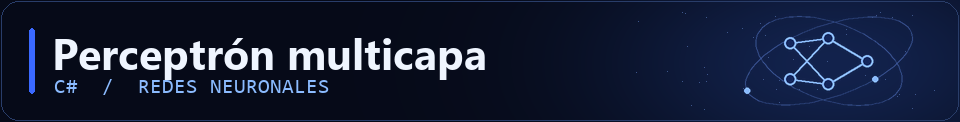

<picture>
  <source media="(prefers-reduced-motion: reduce)" srcset="./assets/poloniodev-banner_062020112026.png">
  
</picture>

## Sobre mí

Soy **Fernando Martinez** (`PolonioDev`), ingeniero de software. Programo desde 2012 y me especializo en **desarrollo web backend, APIs REST y automatización**. Una de las cosas que más disfruto es convertir un proceso manual y repetitivo en algo que pueda ejecutarse por sí solo.

Me apasionan la química, la física y aprender cómo funcionan las cosas. La programación es mi forma de poner a prueba esa curiosidad: la misma pregunta que me lleva a entender una reacción química me lleva a seguir una petición web hasta descubrir qué pasa detrás.

## Qué he construido

<h3><a href="https://github.com/PolonioDev/fastycrypt"></a></h3>

Construí una biblioteca en **TypeScript** sobre **TweetNaCl.js** para cifrar datos y firmar documentos desde una interfaz que admite valores JSON. Incluye cifrado con clave compartida o con clave pública y verificación de firmas.

[Documentación](https://github.com/PolonioDev/fastycrypt#readme) · [Paquete npm](https://www.npmjs.com/package/fastycrypt)

<details>
<summary>Instalación y pruebas</summary>

```sh
npm install fastycrypt
```

Las pruebas de firma muestran cómo verificar un documento con la clave pública del emisor y qué ocurre al intentar leerlo con otra clave. [Ver pruebas de firma](https://github.com/PolonioDev/fastycrypt/blob/master/tests/signer.spec.ts)

</details>

<h3><a href="https://github.com/PolonioDev/PluginArch"></a></h3>

Construí un núcleo en **TypeScript** para extender aplicaciones mediante plugins. Usa eventos para que un plugin pueda interceptar o modificar datos, y admite suscripciones con filtros y un flujo de petición y respuesta. El proyecto está en desarrollo.

[Repositorio](https://github.com/PolonioDev/PluginArch) · [Paquete npm](https://www.npmjs.com/package/pluginarch)

<details>
<summary>Ejemplo de un plugin</summary>

En las pruebas, un plugin intercepta el evento `write` de un logger y modifica el mensaje antes de que se escriba. [Ver el ejemplo en las pruebas](https://github.com/PolonioDev/PluginArch/blob/main/tests/index.spec.ts)

</details>

<h3><a href="https://github.com/PolonioDev/MultiLayerPerceptronCsharp"></a></h3>

Implementé un **perceptrón multicapa en C#** con entrenamiento por retropropagación. El ejemplo usa un conjunto de datos CSV para que una red de dos entradas, dos neuronas ocultas y una salida aprenda la operación lógica XNOR.

[Repositorio](https://github.com/PolonioDev/MultiLayerPerceptronCsharp) · [Código del ejemplo](https://github.com/PolonioDev/MultiLayerPerceptronCsharp/blob/master/Program.cs)

<details>
<summary>Qué aprende la red</summary>

El programa consulta las cuatro combinaciones de entrada después del entrenamiento. En XNOR, la salida esperada es `1` cuando ambas entradas coinciden y `0` cuando son distintas. [Ver la implementación del entrenamiento](https://github.com/PolonioDev/MultiLayerPerceptronCsharp/blob/master/Assets/MultiLayerPerceptron_Module.cs)

</details>

---

[Explorar todos mis repositorios →](https://github.com/PolonioDev?tab=repositories)
